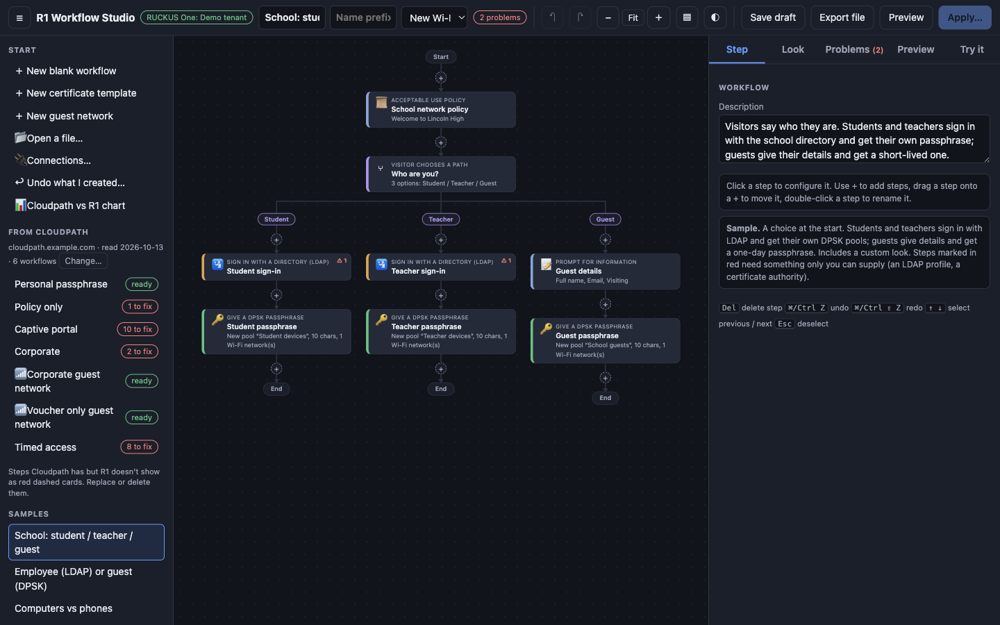
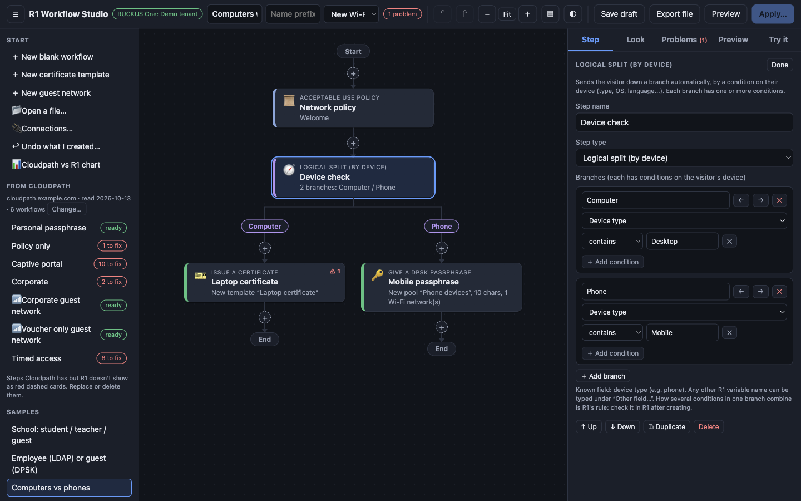
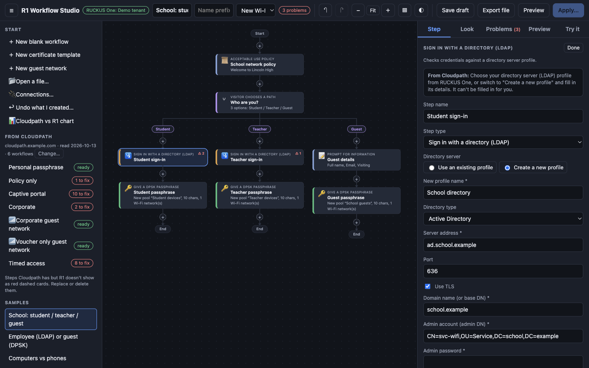
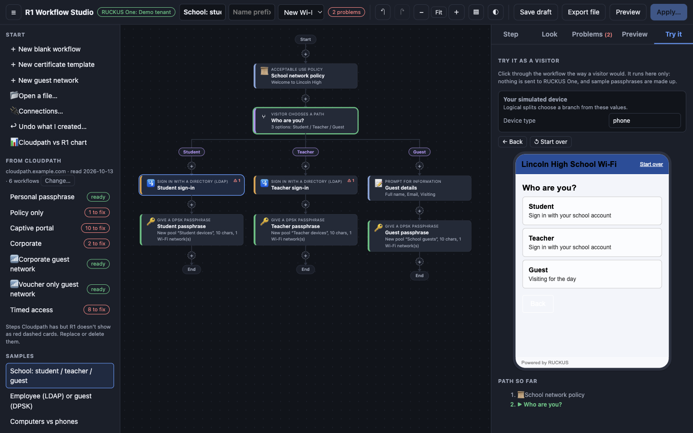
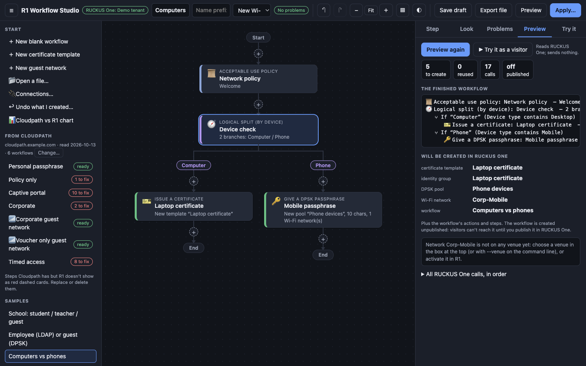
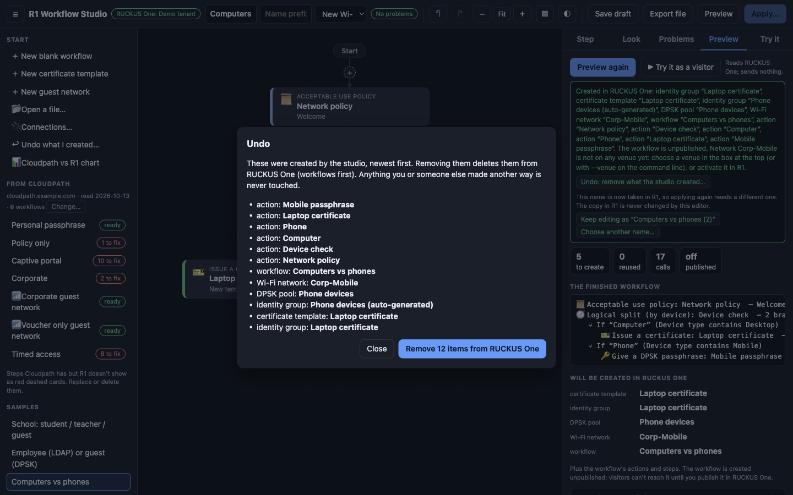
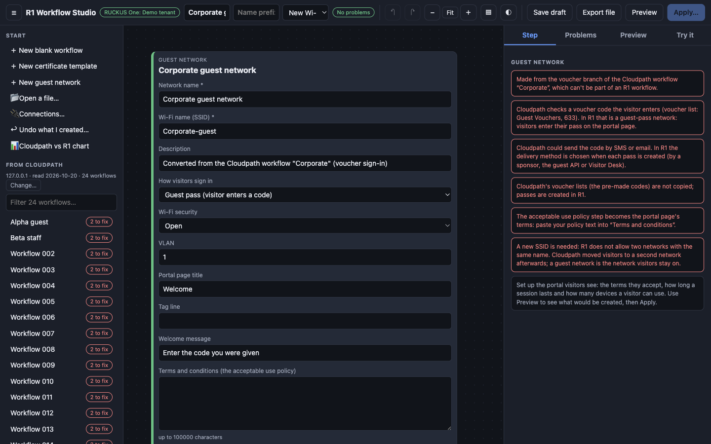
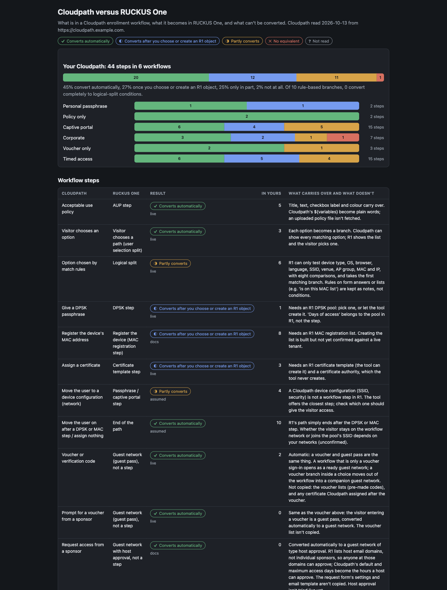

<p align="center"></p>

# R1 Workflow Studio

Design **RUCKUS One enrollment workflows** visually, or read them out of **Cloudpath** and convert them. A desktop app for macOS and Windows.



## Highlights

- **Visual builder.** A flow diagram of Start, step cards, side-by-side branches and End. Add, move, duplicate and undo steps; fix anything listed in **Problems** (RUCKUS One's own rules, checked as you go).
- **Every step type:** acceptable use policy, prompts, messages, visitor choice, **logical split by device** (OS, type, browser), DPSK, MAC registration, certificates, shared passphrase, captive portal, and **directory (LDAP) or SSO sign-in**.
- **Choose or create.** DPSK pools, MAC lists, certificate templates, **directory server profiles and SAML identity providers** can be picked from your tenant or created from the step. The directory admin password is never saved in drafts, exports or logs.
- **Try it as a visitor** in a phone-style frame, with your portal look and feel, before anything exists in RUCKUS One.
- **Safe by design.** **Preview** lists exactly what would be created; **Apply** needs the workflow's name typed to confirm. It only creates new things, leaves workflows unpublished, and **Undo** removes what the studio made.
- **Convert Cloudpath.** Sign in to a Cloudpath instance (read-only, password never saved), convert every workflow, see what each step becomes (vouchers and sponsor approval become guest networks), and view a **Cloudpath vs R1 chart**.
- **Open what you already have** in RUCKUS One as an editable copy, plus certificate templates and guest networks as forms.
- **Private.** Runs on your computer; API secrets are stored encrypted by the operating system.

## See it

| | |
|---|---|
|  **Build** visually |  **Branch** by device |
|  **Choose or create** directory profiles |  **Try it** as a visitor |
|  **Preview** exactly what will be created |  **Undo** what the studio made |
|  **Read** Cloudpath |  **Chart** what converts |

## Get it

Download the latest from the repository's **Releases** page:

| | |
|---|---|
| **macOS** (Apple silicon) | `R1-Workflow-Studio-<version>-mac-arm64.dmg` (or the `.zip`) |
| **Windows** (64-bit) | `R1-Workflow-Studio-<version>-win-x64.exe` installer (or the `.zip`) |

The apps are not code-signed, so macOS and Windows ask for a one-time approval on first open: see **[Installing](docs/user-guide.md#1-installing)**.

## Quick start

1. Open the app. The **Connections** window opens: choose **Add a RUCKUS One tenant…** and enter your tenant ID, client ID and secret (from *Administration > Account Management > Settings > Add Application Token* in RUCKUS One).
2. Open a **sample** from the left list to see a finished workflow, press **Try it** to click through it, or choose **New blank workflow**.
3. Fix anything in **Problems**, press **Preview**, then **Apply…** and type the name to confirm.
4. Converting from Cloudpath? **Connections > Cloudpath**: address, email, password, **Read it now**.

## Documentation

**[User guide](docs/user-guide.md)**, with screenshots of every screen (also attached to each release as a PDF). Technical notes, including every behaviour confirmed against live RUCKUS One and Cloudpath systems, are below.

---

# Technical notes (for developers)

Zero dependencies at runtime (Node 18+); Electron is a development dependency used only to package the desktop app. `npm test` runs the test suite (no network, no real systems: it uses a fake RUCKUS One and a fake Cloudpath). Start the studio in a browser with `node bin/ui.js` (http://127.0.0.1:8787).

## Reading Cloudpath by hand (the older command-line route)
The easy way is the studio's Connections > Cloudpath (it signs in and reads by itself). The manual way:

1. Sign in to the Cloudpath admin UI in a browser.
2. Paste the output of `node bin/crawl-script.js` (the crawler, `crawl/crawl.browser.js` with `crawl/core.js` inlined) into that tab's console. It issues GET requests only (workflow list, each
   step's edit form, each split option's branch) and, with `window.__NO_SEND = true`, keeps the result in
   `window.__crawl`. By default it posts to `node bin/receive.js` on 127.0.0.1:8765, which only works if the
   Cloudpath page's CSP allows it (it did not on cloudpath-lab.example.com); otherwise it downloads `crawl.json`.
3. Put the result at `data/crawl.json`, then `npm run report`. It writes `data/plan.json` and `data/report.md`.
4. `node bin/inventory.js` reads your R1 tenant (read-only; signs in with the `ruckus` block of ../visitor-desk/config.json,
   or R1_* env vars; nothing is printed or copied) into `data/r1-inventory.json`. `node bin/mapping.js` then writes
   `data/mapping.json` (one empty slot per Cloudpath object the plan needs) and `data/mapping-choices.md` (the R1 options).
   `data/mapping.json` maps Cloudpath object names to R1 ids, e.g.
   `{"dpskPools":{"example-ssid pool":{"dpskPoolId":"…","identityGroupId":"…"}},"macLists":{…},"certTemplates":{…},"networks":{…}}`.

`npm test` runs the converter tests.

## The studio (`node bin/ui.js`)
Open http://127.0.0.1:8787 (local only). It shows a workflow as a flow diagram (Start, step cards, choices as side-by-side
branches, End) and lets you change it before anything reaches RUCKUS One:
- **Open** a converted Cloudpath workflow (red dashed cards are steps R1 has no equivalent for: replace or delete them), a saved
  draft, or **a new blank workflow**: the editor works without Cloudpath (`node bin/ui.js` with no `data/crawl.json`).
- **Open what is already in R1**: the left list shows your RUCKUS One workflows and certificate templates. Click one to open an
  **editable copy** (named "… (copy)"): the original is read, never changed, and saving creates a new object under the new name.
  A workflow is read step by step (actions, branches, pools and templates it uses); a certificate template opens as a form
  (authority, CN pattern, validity, organization, algorithm, key length). Anything the editor can't edit yet becomes a red
  placeholder, and problems in the original (R1 marks several of yours INVALID) are listed.
- **Guest networks**: a form object like the certificate template (open one from "Guest networks in R1" as a copy, or "＋ New guest
  network"): SSID, security, VLAN, sign-in type (guest pass, self sign-in, host approval, click through), the portal page (title,
  tag line, welcome message, terms), session and device limits, walled garden. For a Cloudpath workflow with a **voucher step**
  (`Corporate`, `voucherFlow`), select the red voucher step and press **Build a guest network instead**: the form is filled from the
  workflow, with notes on what changed (voucher lists are not copied; passes are made in R1, by a sponsor, the guest API or Visitor Desk).
- **Look and feel** (the **Look** tab of a workflow): welcome title and name, the 8 portal colors, logo size, font, header size,
  "Powered by" and the logo / background / icon images (up to 5 MB each), with a live mock-up. Opening an R1 workflow copies its look,
  logo included. Off by default: R1's own look is used unless you customize it.
- **Try it** (tab, or "▶ Try it as a visitor" in the Preview tab): a phone-style frame, styled with the workflow's look and feel, that you
  click through as the visitor: AUP checkbox, forms (empty fields are refused), messages, choices, sample passphrases and QR code,
  MAC/certificate/sign-in screens, Back and Start over. Logical splits pick their branch from a "simulated device" panel (device type,
  plus any other field the workflow's conditions use). The current step is highlighted on the diagram and the path taken is listed.
  Guest networks get a portal page you can sign in to. It runs entirely in the editor: nothing is sent to R1 and passphrases are made up.
- **Edit on the diagram**: click a step to configure it; `+` adds a step (with search); drag a step onto a `+` to move it (also
  between branches); double-click a step to rename it; duplicate, move up/down, delete. Undo/redo (`⌘/Ctrl Z`, `⇧` for redo), `Del`
  deletes the selected step, `↑ ↓` select the previous/next step, `Esc` deselects.
- **Configure every step** in the right-hand **Step** tab: AUP text, prompts, messages, choices and their options, a DPSK pool
  (pick an existing one or create one with format, length, device limit and its SSIDs), a MAC list, a certificate template
  (existing, or new: authority, CN pattern, validity, organization), passphrase, captive portal, LDAP/SSO (choose an existing directory server / identity provider profile, or create one; the directory admin password is never saved in drafts, exports or logs). Dropdowns are filled
  from your tenant. The **Problems** tab lists everything wrong (missing fields, text over R1's limits, duplicate names, no
  onboarding step in a path...); the same problems show on the cards, and errors block applying. For a step whose DPSK pool, MAC
  list or certificate template is missing or not chosen, **Create if missing** (or **Create all missing objects**), in the Problems tab and in the Preview tab's "Fix these first" list (which previews again by itself), picks the R1 object
  with the wanted name if it exists, otherwise switches the step to create one (filled in from Cloudpath where known; a certificate
  template also needs its authority). Nothing is sent until you preview and apply; undo reverts it.
- **View**: zoom/fit for big workflows (`Ctrl/⌘` + wheel), compact or roomy cards, light/dark/automatic theme, a hideable
  workflow list and a right panel you can drag wider. Your view choices are remembered in the browser.
- **Preview** (tab, or the Preview button) shows the finished workflow as an outline, exactly what would be created (pools, SSIDs,
  templates, the workflow), what is only referenced, and every call in order (with a Copy button). Nothing is sent.
- **Apply** is only enabled after a preview of this exact workflow, and the server re-checks that (a changed workflow must be
  previewed again; a preview works once). You also have to type the workflow's name to confirm. The workflow is created
  unpublished; created objects are appended to `data/created.json` for `bin/undo.js`.
- Safety: listens on 127.0.0.1 only, rejects other Host headers, POSTs need the page's token, and certificate authority
  private keys are never read into the page. `--offline` previews without a RUCKUS One connection (apply is disabled).
- **Samples** (left list): three ready-made workflows to look at, click through with Try it, and edit: school student / teacher / guest
  (LDAP sign-in, a DPSK pool each, one-day guest passphrase, custom look), employee (LDAP) or guest (DPSK), and computers vs phones
  (a logical split by device type: Desktop gets a certificate, Mobile gets a passphrase). They open as editable copies. Only an LDAP directory profile and a certificate authority
  are left for you to fill in. Defined in `src/samples.js`.
- **Export file / Open a file…**: save whatever is open (a workflow, certificate template or guest network) to a `.json` file, and open it
  again later, on another computer, or after sending it to someone. Dropping a file on the page opens it too. A file is never trusted:
  only known step types and fields are kept, ids are made fresh, sizes are capped, unknown step types become red placeholders, and the
  result goes through the same Problems check, preview and typed confirmation as anything else. Steps that point at R1 objects (DPSK pools,
  templates, ...) do so by id, which only means something in the tenant the file came from: the editor warns and flags the ones that
  don't exist where you are. Drafts saved by the editor open as files too. Format (the id `cloudpath-to-r1` is kept so earlier files still open): `{ format: "cloudpath-to-r1", version: 1, kind, name,
  exportedAt, data }` (`src/exchange.js`).
- **Cloudpath vs R1 chart** (left list, or `node bin/coverage.js`, which writes `data/cloudpath-vs-r1.html` and `.csv`): what is in a
  Cloudpath workflow, what it becomes in RUCKUS One and what can't be converted. Counts come from your crawl (steps per type, objects, how
  many rule-based branches convert completely), with a bar per workflow, and each row says whether it converts automatically, after you
  choose or create an R1 object, only in part, or not at all, plus how sure we are (confirmed live, from the docs, assumed, or not crawled).
  Cloudpath areas the crawler doesn't read (authentication servers, notification templates, data, integrations) are listed as "not read"
  rather than guessed. The catalog is in `src/coverage.js`: update it when the tool learns to convert something new.
- **Names already in R1**: if the name is taken (for instance right after you deploy it), the Problems tab offers "Rename to “Name (2)”" (the next free one) or a name of your choice, and after a successful apply the Preview tab offers "Keep editing as …". The name box at the top of the page always renames what is open. The copy already in R1 is never changed by the editor; rename or delete that one in RUCKUS One.
- **Connections** (the green pill in the header, or "Connections…" in the left list): choose which RUCKUS One tenant and which Cloudpath
  instance the editor works with, without restarting it.
  - *RUCKUS One*: keep several tenants (name, region, tenant id, client id, client secret, optional MSP delegated tenant id), test the
    sign-in, and switch between them, the default (environment or Visitor Desk config, as before) or offline. A new connection is signed in
    and read once before it replaces the old one, a failed switch changes nothing, and a switch clears every preview so a preview made on
    one tenant can never be applied to another. The Apply dialog and the header name the connection in use. Secrets are stored in
    `data/connections.json` (mode 600) and never sent to the page: it only sees the last four characters of the ids.
  - *Cloudpath*: type the address, an admin email and the password and press "Read it now". The editor signs in itself, reads the workflows
    (GET requests only, with a progress bar and a Stop button) and signs out. The password is used for the one sign-in call and is never
    saved, shown, logged or sent anywhere but that address (https only; redirects to another address are refused). If the account uses single
    sign-on or a verification code, use "Use a browser console instead…" (it arms a one-time code and gives you the crawler to run in a
    tab you are signed in to; if Cloudpath's security policy blocks it reporting back, it downloads `crawl.json`, which you drop on the page),
    or "Load a crawl file…". Every crawl is kept in `data/crawls/` (named by instance and date), so you can switch back; the active one is
    also written to `data/crawl.json` for the command-line tools. The crawler is `crawl/core.js`, shared by both ways in; the editor parses
    pages with its own small HTML parser (`src/minidom.js`, no dependencies). On a live instance, results with it were identical to the
    browser's own parser on 8 varied workflows (63 steps, 86 forms), and reading does not depend on which option Cloudpath had selected for
    the session (each branch's own form is read from the page where that branch is selected).
    Cloudpath lists are paged (15 rows, at most 100 per page); the crawler follows the pages, so it reads every workflow, and reads only
    the DPSK pools and device configurations that those workflows use. A big instance can have hundreds of workflows (about 2
    seconds each), so the dialog has "only names containing…" and "read at most…" options (also `window.__CRAWL_FILTER`, `__CRAWL_LIMIT`,
    `__CRAWL_PARALLEL` and `__CRAWL_STOP` if you paste the script yourself). Reading 3 workflows at once gives the same result as one at a
    time (tested). The Cloudpath list in the editor has a filter box, and the chart says "N of M read". A crawl never keeps secrets (shared
    passphrases, API keys, OAuth secrets, default passwords): the crawler leaves them out and the editor removes them from any crawl it loads.

## Desktop app (macOS and Windows)

The same studio in its own window, no terminal needed. It runs the studio inside the app and keeps everything you create in its own data folder:
macOS `~/Library/Application Support/R1 Workflow Studio/data`, Windows `%APPDATA%\R1 Workflow Studio\data` (File > Open data folder). API client
secrets are stored encrypted with the system's own store (macOS Keychain, Windows data protection), so a saved connection can only be read by you,
on that computer. First start: with nothing configured it opens Connections, where you add your RUCKUS One tenant and/or read Cloudpath. It uses
the fixed local port 47871 (so its settings survive restarts; if that is busy it picks another) and can run alongside `node bin/ui.js` (port 8787), but
the two keep separate data. To move what you already have, copy a `data/` folder into the app's data folder.

Build it (needs Node 18+; Electron is only a development dependency, the studio itself still has none):

```bash
npm install
npm run dist:mac      # Apple Silicon: dist-app/R1-Workflow-Studio-<version>-mac-arm64.dmg and .zip
npm run dist:win      # Windows 64-bit, built from a Mac: installer .exe and .zip (the .exe file itself keeps Electron's icon)
npm run app           # run it from the source without packaging
```

The user guide is `docs/user-guide.md` (screenshots in `docs/images/`). `node docs/make-screenshots.js` retakes every screenshot from the real app running on made-up data only
(`test/demo-studio.js`: a pretend RUCKUS One and Cloudpath), so no real tenant or Cloudpath data can end up in a picture; `node docs/build-guide.js` builds the guide into one
self-contained HTML file and a PDF in `dist-app/`. Undoing what the studio created is the **Undo** button in the app (`src/undo.js`); `node bin/undo.js` does the same from a terminal.

For a Windows build with the proper icon and file details, run the "Build desktop apps" workflow on GitHub (Actions tab, Run workflow; a `v*` tag also
drafts a release with the files). The apps are not code-signed, because that needs paid Apple and Windows certificates, so the first time:
- macOS: if it says the app can't be opened, right-click it > Open, or run `xattr -dr com.apple.quarantine "/Applications/R1 Workflow Studio.app"`
  (a build made on your own Mac has no such warning). The first run may ask to let the app use its Keychain item; that is the secret storage.
- Windows: SmartScreen shows "Windows protected your PC": More info > Run anyway.

## Step mapping
| Cloudpath | R1 action | Support |
|---|---|---|
| aup | AUP | auto |
| dpsk | DPSK | needs pool + identity group |
| selection, all options open | USER_SELECTION_SPLIT (+ _OPTION) | auto |
| selection with match rules | FUNCTIONAL_SPLIT (+ _OPTION) | manual (rules not mapped yet) |
| registration (MAC) | MAC_REG | needs MAC list + identity group |
| output with certificate template | CERT_TEMPLATE | needs template mapping |
| output after DPSK / MAC | end of path | auto |
| output (other) | PASSPHRASE | needs network mapping, verify |
| oob (voucher / verification code) | an R1 guest network (a guest pass is the same thing; R1 has no voucher step). A workflow that is only a voucher sign-in opens as a guest network automatically; a voucher branch inside a choice is moved out of the workflow into a companion guest network, with a note | auto |
| otp (prompt for a voucher from a sponsor) | same as oob: an R1 guest network (guest pass) | auto |
| req, oobreq (request access from a sponsor) | an R1 guest network of type host approval: sponsor emails become host domains (anyone at those domains can approve), default and maximum access days become the hours a host can approve. Not tried live yet | auto |
| deviceName (name the device, device limit) | a form asking for a device name; the device limit has no R1 step (use "Devices per passphrase" on the DPSK pool) | auto, in part |
| notification (email / SMS) | to the user after a DPSK step: the DPSK step's "Email / Text the passphrase" switches (the step is dropped); to an administrator, or not after a DPSK step: none | auto, in part / manual |
| message, dataPrompt | Show a message; Prompt for information (a password field can't carry over) | auto |
| ss (prompt for a shared passphrase) | "Give the network's passphrase" (PASSPHRASE): hands the visitor a PSK network's passphrase. Choose the network (a same-named R1 network is picked) and its identity group. Dropped, with a note, where a DPSK, MAC registration or certificate step also gives access (R1 allows one access step per path) | needs network + identity group |
| redirect, oauth | none (explained in the step's notes) | manual |
| credprompt, concurrent | none | manual |

R1 specs: https://docs.ruckus.cloud/api (Workflow Management API 0.0.4, Workflow Actions API 0.0.2).
Create order in R1: actions first (`POST` Workflow Actions), then the workflow, steps and split options, then publish.

## Notes
- `data/crawl.json` is a trimmed copy (blank fields dropped, default texts over 150 characters dropped,
  labels shortened) so some names are cut off ("Guest Policy Templat…"). Rerun the crawler for full data.
- Reading a split's branches selects that option in the Cloudpath UI's session view; nothing is saved.
- `data/` is gitignored: it holds your tenant's configuration.

## Guest networks (what the R1 API can set)
From the Wi-Fi API 21.3.5.41.1 and Guest API 2.1.1 specs (docs.ruckus.cloud, read 2026-10-13; not yet called on a tenant).
A Cloudpath workflow of "AUP + voucher code" is an R1 guest network, not an R1 workflow.

- **Network** (`POST /wifiNetworks`, `GuestWifiNetwork`; required `name`, `wlan`, `guestPortal`):
  - `wlan`: `ssid`, `wlanSecurity` (None, OWE, WPA2/3 personal ...), `vlanId`, `passphrase`.
  - `guestPortal.guestNetworkType`: ClickThrough, SelfSignIn, HostApproval, **GuestPass**, WISPr, Cloudpath, Directory, SAML, **Workflow**, None.
  - `guestPortal`: `maxDevices`, `userSessionTimeout`, `userSessionGracePeriod`, `endOfDayReauthDelay`, `lockoutPeriod`,
    `macCredentialsDuration`, `walledGardens`, `redirectUrl`, `enableSmsLogin`, `smsPasswordDuration {duration, unit}`,
    `hostGuestConfig {hostDomains, hostDurationChoices}`, social sign-in options.
  - `guestPortal.guestPage`: `title`, `tagLine`, `welcomeMessage`, **`termsAndConditions`** (the AUP text), `langCode`, logo/advert images.
  - Portal look can also be a reusable portal service profile (`/portalServiceProfiles`: colors, logo, texts, `termsCondition`).
- **Passes** (Guest API, `GuestUserV1`; required `name`, `mobilePhoneNumber`, `maxDevices`, `deliveryMethods`, `expiration`):
  - `expiration {activationType Creation|Login, duration, unit Minute..Year|Never}`, `email`, `notes`, `deliveryMethods` (MAIL, SMS, PRINT).
  - R1 returns the generated `password` (the code). Create one, many (`addGuestUsers`) or bulk (`importGuestUsers`);
    list, update, delete, disable, reset, validate a password (`actionByGuestUserId...`).
- **Workflow on a captive-portal network**: `activateWorkflowProfileOnWifiNetwork` (Wi-Fi API, workflow assignment).

How a Cloudpath voucher step maps:
| Cloudpath | R1 guest network |
|---|---|
| Voucher list (sponsor makes codes) | Passes in the guest network; made by sponsors or the API, bulk with `importGuestUsers` |
| Send code by email / SMS (`allowEmail`, `allowSms`) | `deliveryMethods` MAIL / SMS |
| Code lifetime on the voucher list | `expiration` on each pass |
| AUP step text | `guestPage.termsAndConditions` |
| Sponsor portal look | portal service profile |

Not settled: whether R1 can create passes in advance like a Cloudpath voucher batch is covered by `importGuestUsers`,
but nothing here checks that the visitor can type in a code they were sent (the pass password) instead of being
emailed it after signing up: that is how `GuestPass` portals work in the R1 UI. Confirm on a tenant.

## Building in RUCKUS One (`bin/build.js`)
```
node bin/build.js                      # dry run: reads your tenant, prints every call it would make, writes nothing
node bin/build.js --create-missing     # dry run that also plans the DPSK pools / identity groups / MAC pools / SSIDs
node bin/build.js --apply --create-missing --workflow "Policy only" --workflow personalPassphrase --venue <venueId>
node bin/undo.js [--yes]               # delete exactly what the last --apply created
```
Options: `--objects-only` (create only the pools/templates/SSIDs a workflow needs), `--allow-partial`, `--prefix CP-`, `--format numbers|keyboard|secure|words`, `--vlan N`, `--offline`, `--no-rollback`.

What it does, per workflow (left **unpublished**):
1. Resolves each step's Cloudpath object. A mapping in `data/mapping.json` wins; otherwise an R1 object with the same name is
   reused (never edited); otherwise, with `--create-missing`, it is created:
   - DPSK pool: identity group, `POST /dpskServices` (length from Cloudpath, `--format` for the format), link to the group, and
     a DPSK SSID for each SSID Cloudpath lists on the pool (linked to the pool, optionally activated on `--venue`).
   - MAC registration list: identity group + `POST /identityGroups/{id}/macRegistrationPools` with Cloudpath's validity.
   - Certificate template (R1 Certificate Management): `POST /certificateAuthorities/{caId}/templates` with the template's
     CN pattern (`${USERNAME}` becomes `$(USERNAME)`) and validity read from Cloudpath, plus an identity group of the same name.
     It needs an existing R1 certificate authority: `--ca NAME`, or an R1 CA with the same name as Cloudpath's issuing CA, or
     `certAuthorities` in mapping.json. This tool never creates a CA.
   - Networks used by PASSPHRASE steps are not created: map them.
2. `POST /workflows`, then for each step an enrollment action and a step after the previous one; split options get their own
   branch. Workflows with rule-based splits are skipped; steps with no R1 equivalent skip the workflow unless `--allow-partial`.
3. If anything fails during `--apply`, what the run created is deleted again (newest first). `data/created.json` lists it.

Live results (2026-10-13, your tenant):
- Confirmed: `POST /workflows`, `POST /enrollmentActions` (AUP), `POST /workflows/{id}/steps/{stepId}/nextSteps` with
  `"type":"stepDto"` (the overview text says `/steps/{stepId}`, which 404s), and deleting workflows/actions. R1 does creates
  in the background (202), so the builder waits for each object to be readable before using it, and before rolling it back.
- R1 marks a workflow INVALID unless every branch has an onboarding action (DPSK, MAC registration, certificate, passphrase,
  captive portal), so the builder skips workflows without one (`--allow-invalid` overrides) and reports R1's verdict after a build.
- Confirmed (personalPassphrase trial): `POST /dpskServices` (R1 makes the pool's own identity group, named
  `<pool>_auto-generated-from-dpsk_...`; the builder uses it and does not create another), `POST /wifiNetworks` (type `dpsk`;
  the answer has no id, so the builder finds the SSID afterwards) and `PUT /wifiNetworks/{id}/dpskServices/{poolId}` (the pool
  then lists the network), and a DPSK action + step: the workflow reads back VALID. Deleting a workflow is asynchronous: its
  action can only be deleted once the workflow is really gone (undo and rollback wait for that).
- Confirmed (certificate template trial, `--objects-only`): `POST /certificateAuthorities/{caId}/templates` with an identity group
  (created first; templates, unlike pools, do not make their own) creates the template with the CN pattern, validity
  (30 days / 1 year, starting 1 month back), SHA-256, organization and location read from Cloudpath.
- Confirmed (Corporate trial): a user-selection split. The split step must be created with `firstSplitOption` inside it
  (`"type":"splitStepDto"`); the other options are added with `POST .../splitOptions`; each branch's first step goes under
  `POST .../splitOptions/{optionId}/nextSteps`. Limits seen: step label 32 characters, option text 100. Wait for each option to be
  readable before touching the split (a branch step posted too early gets "Validation failure").
- Confirmed (editor, imported certificate template): opening `Lab Template` from R1, editing the copy (name, description, CN pattern, 3 months,
  organization) and applying created a new template + identity group with those values; the original was unchanged.
- Confirmed (guest network and look and feel): `POST /wifiNetworks` with `type:"guest"` and a `GuestPass` portal creates the network
  with the portal page text; `POST /workflows/{id}/uiConfigurations` (multipart: the JSON plus logo/background/icon files) stores the
  title, colors and a 2.1 MB logo (R1 can take 30+ seconds to process it). Images come back from
  `GET /workflows/{id}/uiConfigurations/{logo|background|icon}` as a signed link, served as a generic octet-stream.
- Confirmed (logical split, read from a split made in the R1 GUI, workflow `a test workflow`): R1's "Logical Split" is the `FUNCTIONAL_SPLIT`
  step; each branch is an option whose action carries `evaluationConditions: [{ sourceActionId, variableName, operation, evaluationRegex }]`
  (values confirmed on real devices through the published workflow URL, 2026-10-13: a MacBook gave `CP_DEVICE_TYPE` `Desktop` and `CP_DEVICE_OS` exactly `macOS`; an iPhone gave `CP_DEVICE_TYPE` containing `Mobile` but not equal to it (use CONTAINS; the full text is unknown), `CP_DEVICE_OS` `iOS`; Safari on both gave `CP_BROWSER_NAME` exactly `Safari` (no "Mobile Safari"). When no branch matches, R1 seems to fall to the first branch. R1's Preview does NOT evaluate splits (it shows every branch as a button). Not yet seen: tablets, Android, Windows, Chrome/Firefox/Edge names. R1 allows at most 10 branches in a split). R1 accepts exactly eight comparisons (it lists them when given a wrong one): EQUALS, DOES_NOT_EQUAL, IS,
  IS_NOT, CONTAINS, DOES_NOT_CONTAIN, STARTS_WITH, ENDS_WITH; it does not check variable names. The editor has a **Logical split** step with branches and
  conditions, imports existing ones, and built a nested split live.
  Field names, read from the R1 GUI's Logical Split dialog: Device type `CP_DEVICE_TYPE`, Device OS `CP_DEVICE_OS`, Browser name `CP_BROWSER_NAME`,
  Language `CP_LANGUAGE`, Captive portal SSID `CP_PORTAL_SSID`, Venue name `CP_VENUE_NAME`, AP group `CP_AP_GROUP_NAME`, Device MAC address
  `CP_DEVICE_MAC`, Device IP address `CP_DEVICE_IP`. The dialog also offers the fields of an earlier form step (e.g. "Username"); how those are stored
  isn't known, so a condition on one (`sourceActionId`) is kept by name only when importing.
- Cloudpath split rules are converted to those conditions where R1 can express them: operating system -> Device OS, user agent -> Browser name
  (approximate), language -> Language; a regex becomes equals / contains / starts with / ends with (or the negation of equals / contains); anything
  else (MAC registration lists, user group, email, certificates, vouchers, alternation patterns...) is left as a note on the branch, which then needs
  conditions set by hand. An "otherwise" branch has no condition; R1 has no "else", so the editor flags it. In the training instance every
  rule tests a MAC registration list, so none converted automatically.
- Confirmed (builder rules learned live): R1 allows **no two enrollment actions with the same name in the tenant** (every action gets a
  short unique suffix); step labels are at most 32 characters; R1 lists return **10 per page** (the importer pages through all of them).
- Cloudpath look and feel is read by the crawler (each workflow's Look & Feel tab) and converted: titles and any customized colors map to
  R1's look; page styles, custom HTML/CSS and image files do not (listed as notes). In your training instance everything is default
  except two welcome titles.
- Not yet confirmed live: MAC registration pools, activating an SSID on a venue (`--venue`),
  and applying a workflow that creates new pools/templates from the editor. Confirmed: the editor's Apply with an existing pool
  (AUP + DPSK, VALID in R1, recorded in data/created.json). Try each kind on one small workflow, check it in the R1 UI,
  then `bin/undo.js --yes`.
`npm test` runs the converter and the builder against a fake R1.
