# R1 Workflow Studio: User Guide

R1 Workflow Studio is a desktop app for macOS and Windows. With it you can:

- **design RUCKUS One enrollment workflows visually**, step by step, and see exactly what a visitor would see before anything exists;
- **open what you already have in RUCKUS One** as an editable copy;
- **read workflows out of Cloudpath** and convert them into RUCKUS One workflows, with a chart of what converts and what can't;
- **create the result in RUCKUS One** (DPSK pools, certificate templates, guest networks, Wi-Fi networks, the workflow itself), and **undo** it again.

> **The safety promises.** Nothing is sent to RUCKUS One until you preview exactly what would be created and then type the workflow's name to confirm. The studio only ever creates new things: it never edits or deletes anything that was already there, and Undo removes only what the studio itself created. Your Cloudpath password is used once to sign in and is never saved. API secrets are stored encrypted by your computer.

The pictures in this guide were taken with made-up demo data.

---

## 1. Installing

**Mac (Apple silicon).** Open `R1-Workflow-Studio-<version>-mac-arm64.dmg` and drag *R1 Workflow Studio* to *Applications*. The app is not signed with an Apple developer certificate, so the first time macOS may say it can't be opened. Right-click the app, choose **Open**, then **Open** again. (If you'd rather use Terminal: `xattr -dr com.apple.quarantine "/Applications/R1 Workflow Studio.app"`.) You only do this once. The first time it saves a connection secret, macOS may also ask whether the app may use its Keychain item: that is where the secrets are kept, so allow it.

**Windows (64-bit).** Run `R1-Workflow-Studio-<version>-win-x64.exe`. Windows SmartScreen may show "Windows protected your PC" because the app isn't signed: choose **More info**, then **Run anyway**. The installer lets you choose the folder and adds a desktop shortcut. A `.zip` version needs no installation: unzip it and run *R1 Workflow Studio.exe*.

**Where your data lives.** Everything you create (crawls, drafts, saved connections, the undo list) is kept in the app's own folder: on a Mac `~/Library/Application Support/R1 Workflow Studio/data`, on Windows `%APPDATA%\R1 Workflow Studio\data`. In the app, **File ▸ Open data folder** takes you there. Uninstalling the app does not delete this folder; delete it yourself if you want everything gone.

---

## 2. First start: connect to RUCKUS One

On a fresh install the **Connections** window opens by itself.

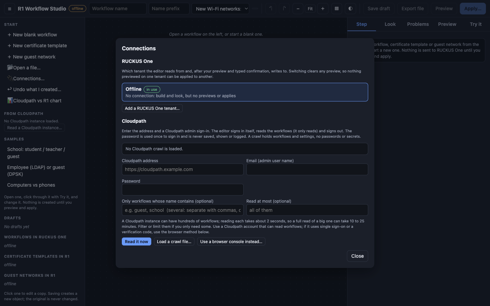

Until you add a connection the studio is **Offline**. You can still design workflows, try them out as a visitor, and open samples, but you can't preview against your tenant or create anything.

### Add your RUCKUS One tenant

Choose **Add a RUCKUS One tenant…**.

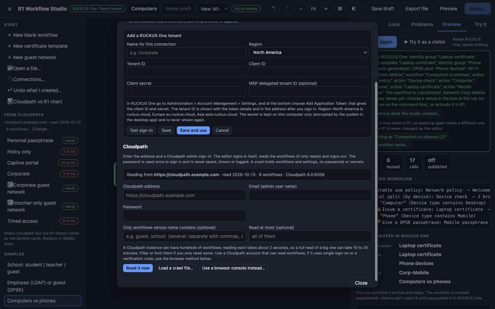

| Field | What to enter |
|---|---|
| **Name for this connection** | Anything that helps you tell tenants apart, for example *Corporate* or *Lab*. |
| **Region** | Where your RUCKUS One account lives: North America (`ruckus.cloud`), Europe (`eu.ruckus.cloud`) or Asia (`asia.ruckus.cloud`). |
| **Tenant ID**, **Client ID**, **Client secret** | In RUCKUS One go to **Administration ▸ Account Management ▸ Settings** and, at the bottom, choose **Add Application Token**. That gives you the client ID and client secret (save the secret: it is shown once). The tenant ID is shown with the token details and in the address after you sign in. |
| **MSP delegated tenant ID** | Only if you are a managed service provider working in a customer's tenant. Otherwise leave it empty. |

Press **Test sign-in** to check the values without saving anything, then **Save and use**. The studio signs in and reads your tenant once before it switches, so a typing mistake changes nothing.

- The **client secret is stored encrypted** with your computer's own protection (macOS Keychain, Windows data protection) and is never shown again, not even to you. To change it, choose **Edit** and type a new one; leaving the field empty keeps the saved one.
- You can keep **several tenants** and switch between them in this window. Switching clears any preview, so something you previewed on one tenant can never be applied to another. The **Apply** window always names the connection it will use.
- **Offline** disconnects the studio completely.

The green pill in the top bar shows which connection is in use. Click it any time to reopen this window.

---

## 3. The window

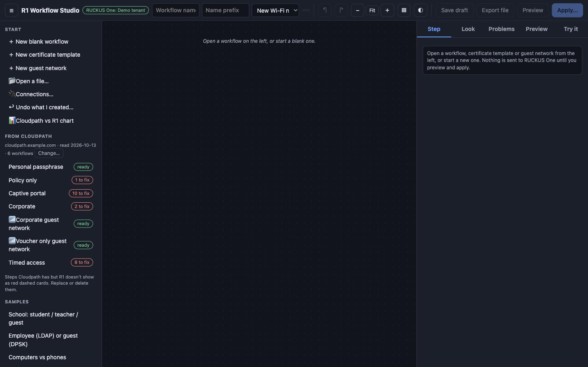

**Left: your lists.**

- **Start**: a new blank workflow, a new certificate template, a new guest network, *Open a file…*, *Connections…*, *Undo what I created…* and the Cloudpath chart.
- **From Cloudpath**: workflows you have read from Cloudpath (section 8).
- **Samples**: three ready-made workflows to look at and learn from.
- **Drafts**: your saved work in progress.
- **Workflows, certificate templates and guest networks in RUCKUS One**: what already exists in the connected tenant. Click one to open **an editable copy**; the original is never changed.

**Middle: the canvas.** The workflow as a tree. Click a step to edit it, click a **+** to add a step, drag a step onto a **+** to move it, double-click a step to rename it. **Fit** fits the whole tree in view; **−** and **+** zoom.

**Right: the tabs.** **Step** (edit what is selected), **Look** (the visitor's page style), **Problems** (what must be fixed), **Preview** (what would be created) and **Try it** (click through it as a visitor).

**Top bar.** The workflow's name, an optional **Name prefix** (put in front of every name it creates, handy for tagging a trial), a **venue** menu (where new Wi-Fi networks should be activated), the problems pill, undo and redo, zoom, **Save draft**, **Export file**, **Preview** and **Apply…**.

**Keyboard.** `Delete` removes the selected step. `⌘ Z` / `Ctrl Z` undo, `⇧ ⌘ Z` / `Ctrl ⇧ Z` redo. `↑` and `↓` move the selection. `Esc` deselects.

---

## 4. Building a workflow

Start with **New blank workflow**, or open a **sample** to see a finished one.

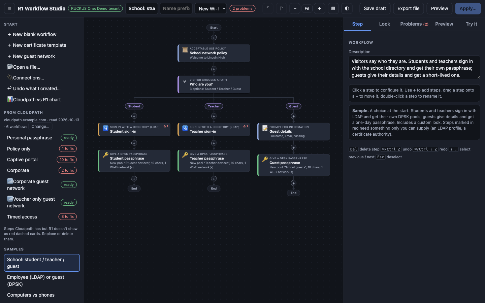

This sample asks visitors who they are. Students and teachers sign in with the school directory and get their own passphrase; guests fill in a form and get a short-lived one.

### The steps you can use

| Step | What it does |
|---|---|
| **Acceptable use policy** | Shows terms the visitor must accept. |
| **Prompt for information** | Asks for a name, email, phone or custom fields. |
| **Show a message** | Shows text, and can end the session. |
| **Visitor chooses a path** | Buttons; each option is its own branch. |
| **Logical split (by device)** | Sends the visitor down a branch automatically, by a condition on their device. |
| **Give a DPSK passphrase** | A personal Wi-Fi passphrase from a DPSK pool. |
| **Register the device (MAC)** | Adds the device to a MAC registration list. |
| **Issue a certificate** | Installs a client certificate from a certificate template. |
| **Give the network's passphrase** | Hands out a network's shared (PSK) passphrase. |
| **Captive portal redirect** | Sends the visitor on to a web address. |
| **Sign in with a directory (LDAP)** | Checks credentials against a directory server profile. Pick one that already exists in RUCKUS One, or choose **Create a new profile** and fill in its server address, port, domain and admin account. The admin password is sent to RUCKUS One but never saved in drafts, exported files or logs, so type it again after reopening a draft. |
| **Sign in with SSO (SAML)** | Checks credentials against an identity provider. |

### The rules RUCKUS One enforces (the Problems tab checks them for you)

- **Every path through the workflow needs exactly one "give access" step**: a DPSK passphrase, a MAC registration, a certificate, the network's passphrase, or a captive portal redirect. Not none, and not two.
- A **split can have at most 10 branches**, and nothing can come after a split (everything continues inside its branches).
- Names have length limits, and a workflow name that already exists in RUCKUS One is refused. The studio offers **Rename to "Name (2)"** when that happens.

### Editing a step

Click a step and use the **Step** tab.

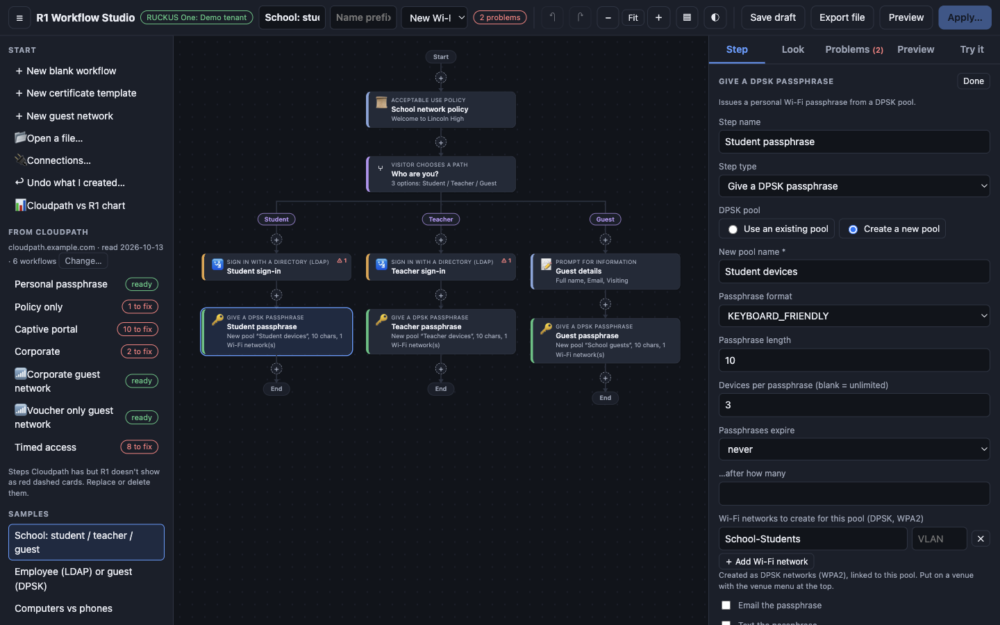

For a DPSK step you choose an **existing pool** or **create a new one** (name, passphrase format and length, devices per passphrase, when passphrases expire, and the Wi-Fi networks that go with it). Things that don't exist yet are created for you when you apply, and listed first in the preview.

### Logical splits: branching by device

A **Logical split** decides the branch by itself from facts about the visitor's device, with no button to press.

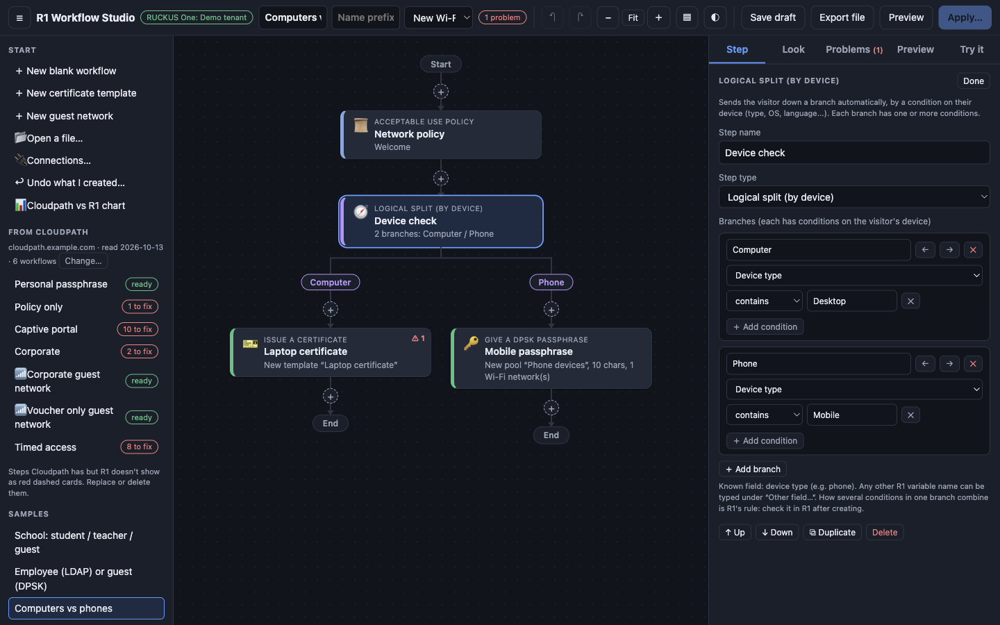

Each branch has one or more conditions: a field (device type, operating system, browser, language, SSID, venue, AP group, MAC address or IP address), a comparison (equals, contains, starts with…) and a value. The first branch whose conditions match is taken. Values confirmed on real devices: a Mac reports device type `Desktop` and OS `macOS`; an iPhone reports type `Mobile` and OS `iOS`; Safari reports browser `Safari`. When in doubt use **contains**.

### The visitor's page style: Look

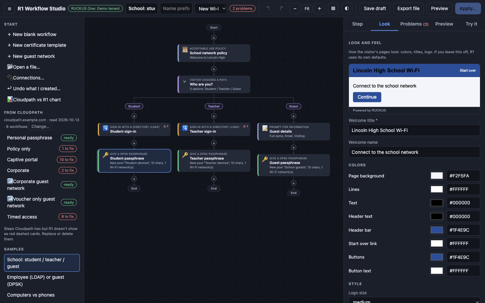

Set the welcome title, colours, font and logo or background image the visitor's pages use.

### Problems

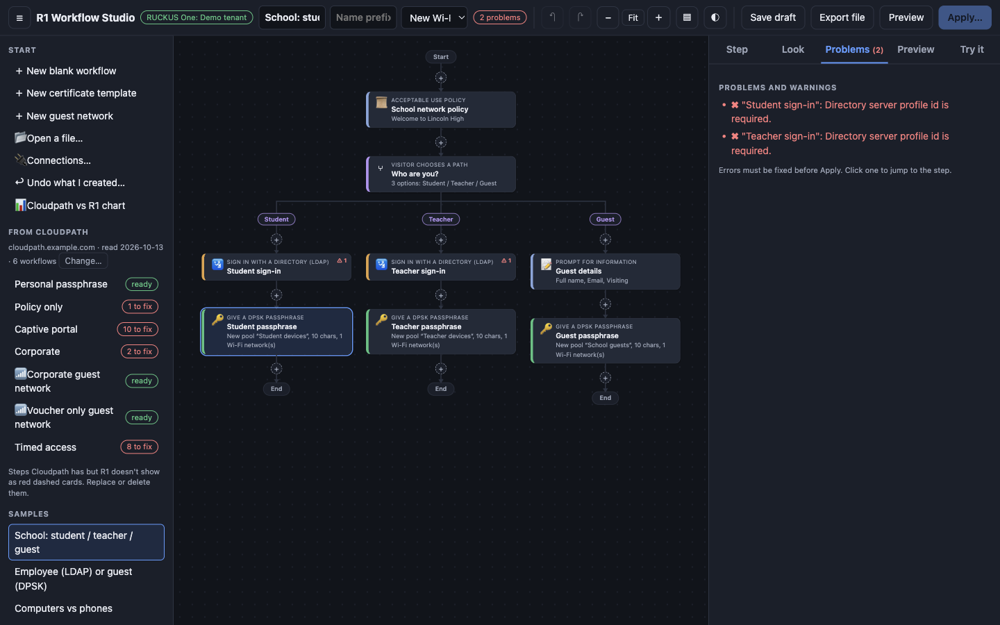

Anything that would stop RUCKUS One accepting the workflow is listed here (and the red number in the top bar counts them). Click a problem to jump to the step. In the sample above, the two sign-in steps need a **directory server profile id**: that profile lives in your RUCKUS One tenant, so only you can supply it.

### Try it as a visitor

Press the **Try it** tab to click through the workflow the way a visitor would, in a phone-style frame using your look. It runs only inside the studio: nothing is sent to RUCKUS One, and passphrases shown are made up.

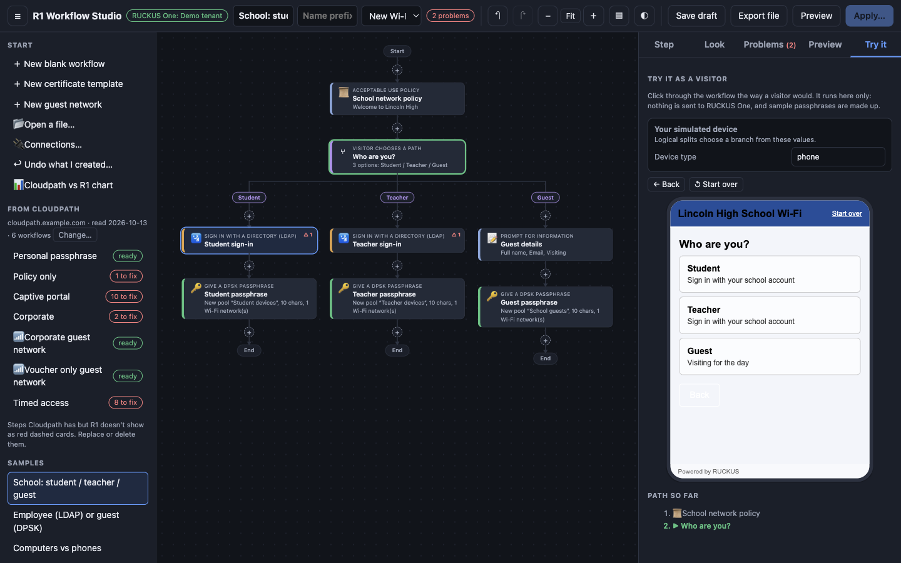

For logical splits, set the **simulated device** at the top (for example device type `Mobile`) and watch which branch it takes. The **Path so far** list shows where you have been.

---

## 5. Preview, apply, and undo

### Preview

**Preview** reads your RUCKUS One tenant and shows exactly what would be created. It sends nothing.

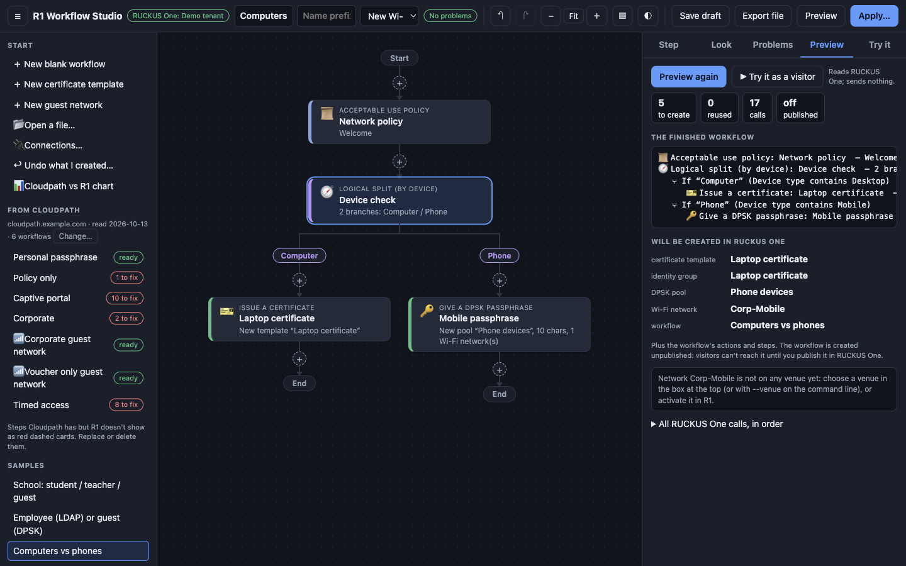

You see the finished workflow, a count of what will be created and what already exists and would be reused, and a list of every object, then every call in order.

### Apply

**Apply…** only lights up when the workflow has no problems **and** you have previewed exactly this version. If you change anything after a preview, preview again.

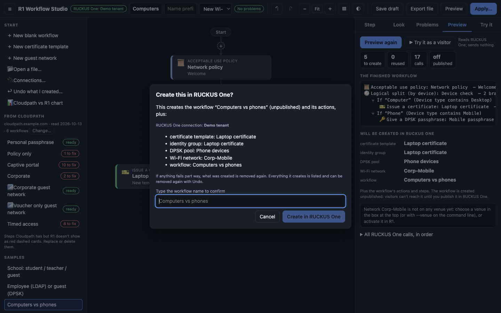

The window repeats what will be created and which connection it goes to, and asks you to **type the workflow's name**. Only then does **Create in RUCKUS One** work.

- Everything is created **unpublished**: visitors can't reach it until you publish it in RUCKUS One.
- If anything fails part way, whatever was created is **removed again**.
- Creation in RUCKUS One happens in the background; the studio waits and checks each piece.

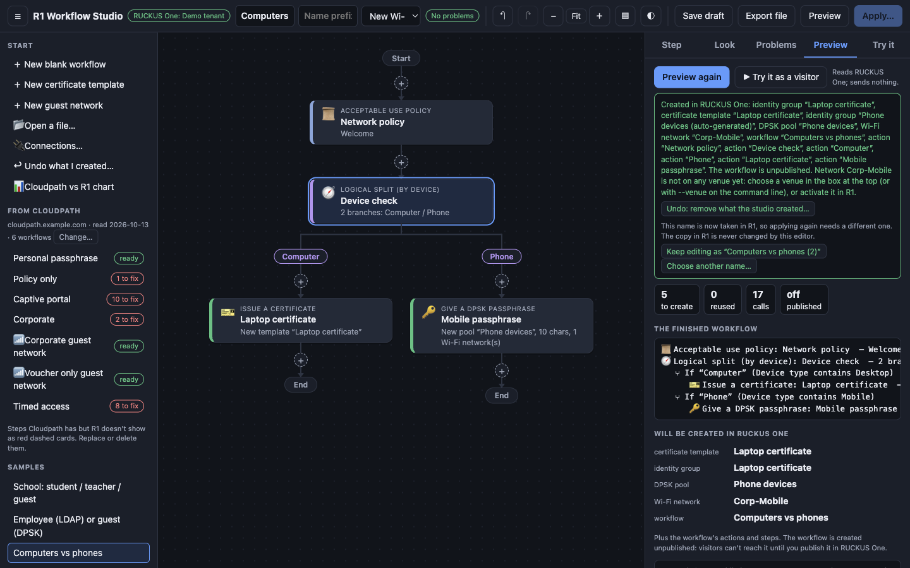

After a successful apply the name is taken in RUCKUS One, so you can **Keep editing as "Name (2)"** to make a variation.

### Undo

**Undo what I created…** (in the Start list, or on the success message) lists everything the studio has created, newest first.

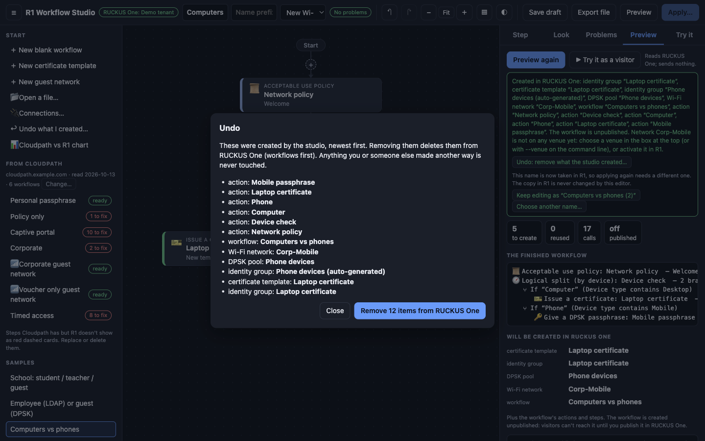

**Remove … items from RUCKUS One** deletes exactly those, workflows first. It never touches anything the studio didn't create, and an entry made through one connection can only be removed through that same connection.

---

## 6. Working with what's already in RUCKUS One

Click a workflow, certificate template or guest network under **…in RUCKUS One** to open **an editable copy**. Change it as you like and apply: the result is a **new** object. The original is never changed, and a copy needs a new name.

---

## 7. Saving, exporting and opening files

- **Save draft** keeps your work in the app (listed under Drafts).
- **Export file** saves what is open (a workflow, certificate template or guest network) as a `.json` file you can keep, send to a colleague, or open on another computer.
- **Open a file…**, or simply **drag the file onto the window**, opens it again. Files are never trusted: only known step types and fields are kept, and everything goes through the same Problems check, preview and confirmation as anything else. Steps that point at RUCKUS One objects (a pool, a template) do so by an id that only exists in the tenant the file came from, so the studio warns you and the Problems tab shows what is missing.

---

## 8. Cloudpath: reading and converting

### Reading a Cloudpath instance

Open **Connections…** and use the **Cloudpath** section.

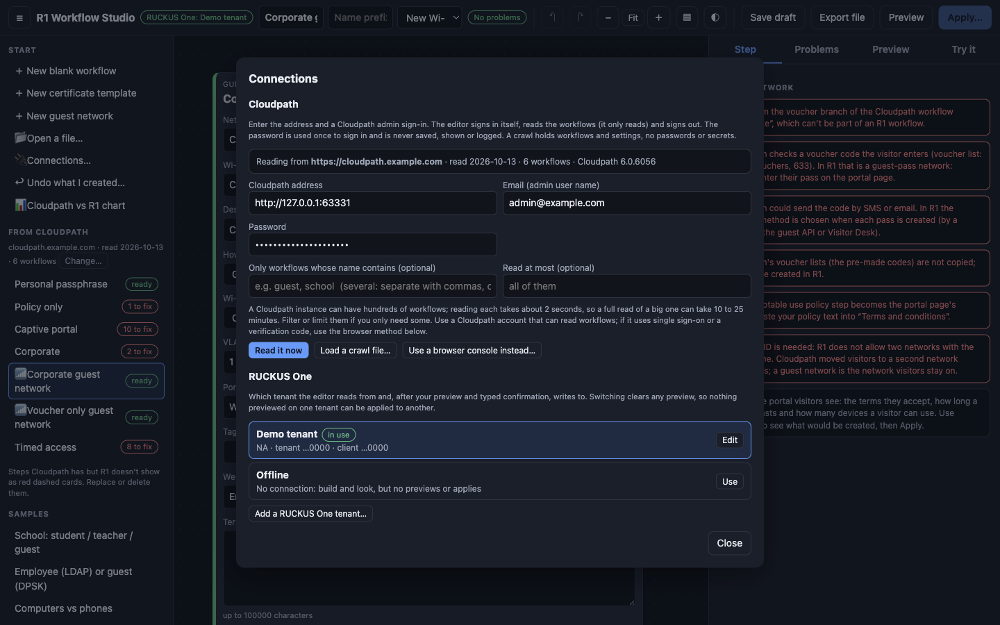

1. Enter the **address** (for example `https://yourcompany.cloudpath.net`), the **email** of a Cloudpath admin and the **password**.
2. Optionally restrict what is read: **Only workflows whose name contains…** (words separated by commas, or a `/regular expression/`) and **Read at most…**. A big instance can have hundreds of workflows and reading each takes about two seconds, so a full read can take 10 to 25 minutes.
3. Press **Read it now**.

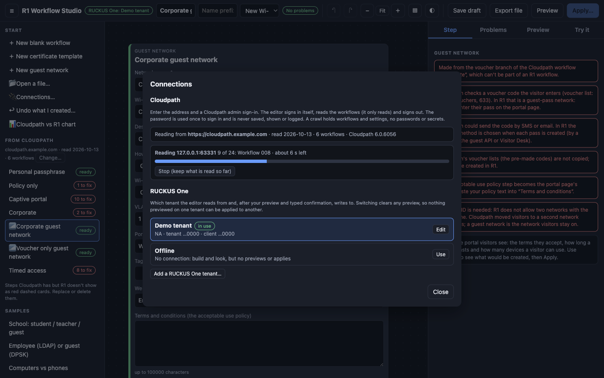

The studio signs in itself, reads the workflows (it **only reads**), and signs out. You can **Stop** at any time and keep what was read so far. The password is used once to sign in and is **never saved, shown or logged**; the address and email are remembered, the password never. Only `https://` addresses are accepted.

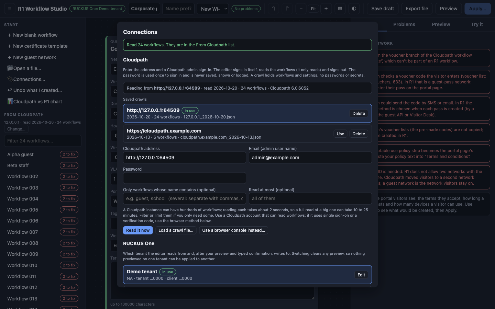

Every read is kept as a **saved crawl**, so you can switch between instances with **Use** and remove old ones with **Delete**. A crawl holds workflows and settings; the studio removes secrets (shared passphrases, API keys, OAuth secrets) from anything it reads.

**If your Cloudpath uses single sign-on or a verification code,** use **Use a browser console instead…**: the studio gives you a one-time script to run in your own signed-in browser tab. If Cloudpath's security policy blocks it from reporting back, the script downloads a `crawl.json`, which you drop onto the studio window (or choose **Load a crawl file…**).

### The converted list

Everything you read appears under **From Cloudpath**.

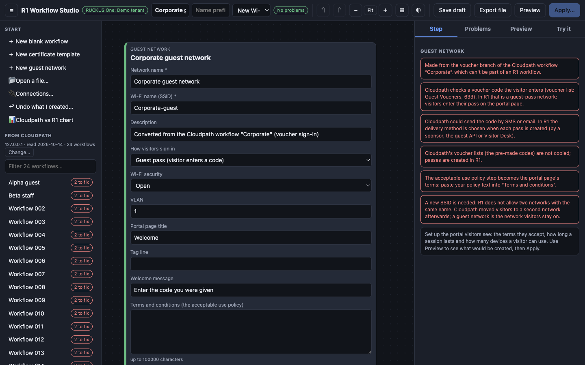

A box filters the list when there are many. Each entry says **ready** or **N to fix**. A 📶 entry is a **guest network** (see below).

### A converted workflow

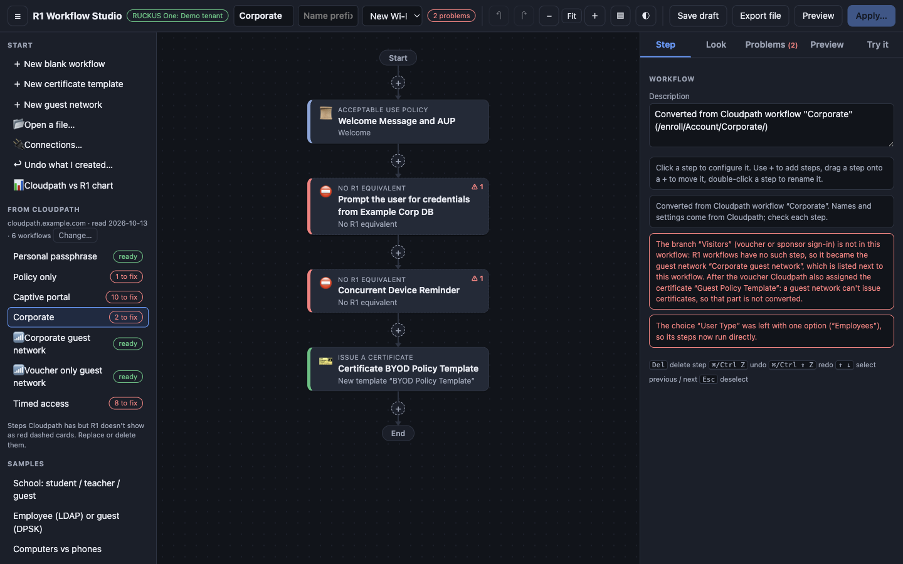

- Steps with no RUCKUS One equivalent appear as **red "No R1 equivalent" cards** with an explanation. Replace each with a suitable step, or delete it.
- Notes about the conversion (what was moved, merged or not carried over) are shown with the workflow and on the steps.

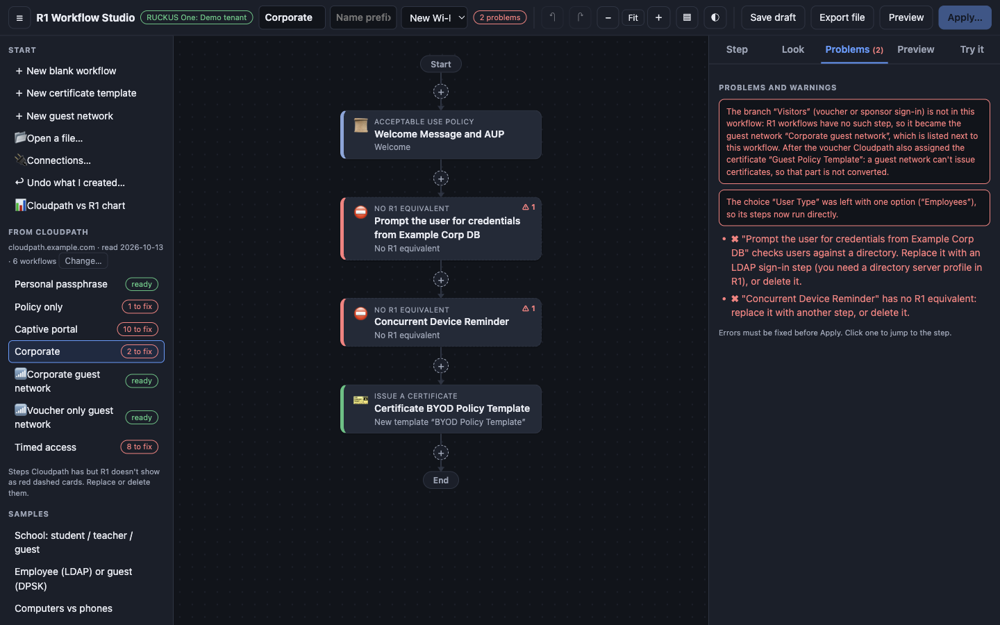

The Problems tab says exactly what to do. For a credentials step it says which user source it used:

- **Cloudpath's internal (Onboard) user database** is designed for **testing only and should not be used in production**. RUCKUS One has nothing like it: move those users to a real directory and use an LDAP sign-in step.
- **A directory (Active Directory, LDAP)** can be replaced by an LDAP sign-in step, choosing (or creating) the directory server profile right in the step. **Sign in with SSO (SAML)** works the same way: choose an identity provider or create one from its metadata address.

Where a step needs a RUCKUS One object (a DPSK pool, a MAC list, a certificate template), the Problems tab offers **Create if missing**: it picks the existing object with that name, otherwise sets the step up to create it.

### Vouchers and sponsor approval become guest networks

In RUCKUS One a voucher or a guest pass is a **guest network**, not a workflow step. So:

- A voucher step (and a "prompt for a voucher") becomes a **guest network of type guest pass**.
- A **request access from a sponsor** step becomes a guest network of type **host approval**: sponsor email addresses become host domains (anyone at those domains can approve), and Cloudpath's default and maximum access days become the hours a host can approve.
- A workflow that is only a voucher or sponsor sign-in opens directly as that guest network. If a voucher sits inside one branch of a larger workflow, the branch is moved out into a companion guest network (listed next to the workflow, with a note), and the workflow keeps its other branches.

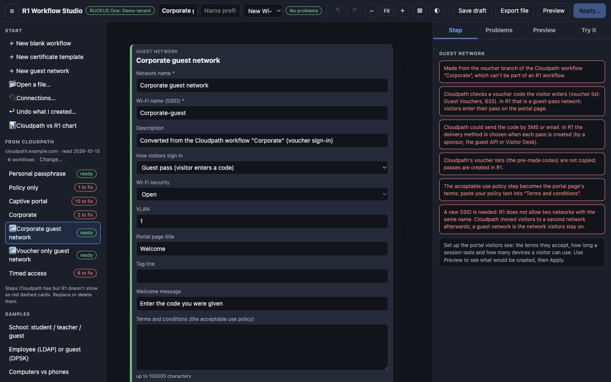

A new Wi-Fi name (SSID) is needed because RUCKUS One doesn't allow two networks with the same name, and the acceptable use text becomes the portal's terms: paste yours in.

### What converts, and what doesn't

Open **Cloudpath vs R1 chart** for a page that shows, for *your* workflows, what converts automatically, what converts after you choose or create a RUCKUS One object, what converts only in part, and what has no equivalent, with a bar per workflow.

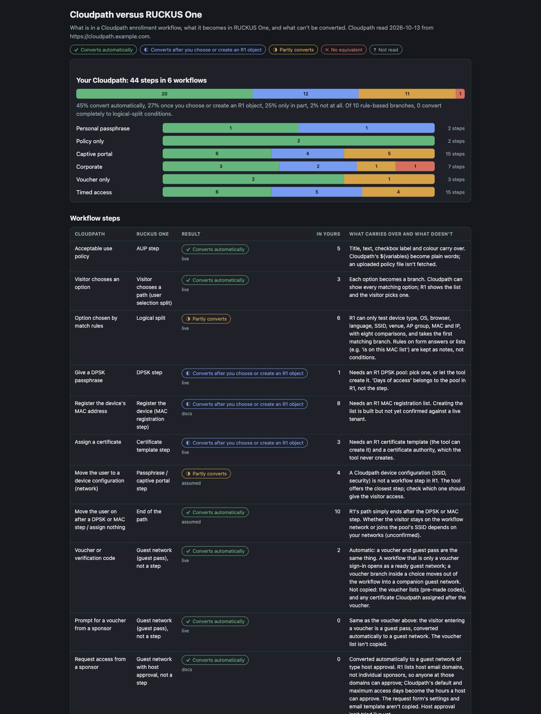

Each row also says how sure we are: *live* (confirmed against a real tenant), *docs* (from RUCKUS's documentation, not tried live), *assumed*, or *not crawled*. The chart can be downloaded as a CSV file.

Things that never convert, by design: certificate **authorities** and their keys, Cloudpath's portal address, custom portal pages (HTML, CSS, page packages), voucher lists, and social-login or internal-database sign-ins. Cloudpath's secrets (shared passphrases, API keys) are never copied.

---

## 9. Privacy and security

- The studio runs **only on your computer**. It listens on `127.0.0.1` (port 47871) and refuses anything that isn't local. It has no analytics and sends nothing anywhere except to **your RUCKUS One tenant** (to preview and to create) and **the Cloudpath address you give it** (to read).
- **RUCKUS One secrets** are encrypted with your operating system's own store and are never shown, logged or sent to the studio's own pages.
- **Your Cloudpath password** exists only while signing in. It is not stored, not logged, and not included in error messages.
- Crawls are stored without secrets. Drafts, exports and the undo list contain workflow content and names, no credentials.
- **Using more than one tenant:** previews are cleared when you switch, and each created object remembers the connection that made it.

---

## 10. Troubleshooting

**The Apply button is grey.** Fix everything in **Problems**, press **Preview**, and don't edit anything afterwards. Also check the top-bar pill says you are connected, not *offline*.

**"A workflow named … already exists in R1."** Use **Rename to "Name (2)"** in Problems, or type another name in the name box at the top. The copy in RUCKUS One is never changed by the studio; rename or delete that one in RUCKUS One.

**Cloudpath says the email and password aren't accepted.** Check the address (it should show the Cloudpath sign-in page) and that the account is a Cloudpath admin. The studio tries once per click, so it won't lock the account by retrying. If the account uses single sign-on or a verification code, use the browser console method.

**A read stopped part way, or says the session ended.** Cloudpath signs users out after a while, or if someone signs in as the same user elsewhere. Press **Read it now** again, or use **Only workflows whose name contains…** to read just what you need.

**A saved connection says "secret can't be read here".** Secrets are tied to your user and computer. Choose **Edit** and enter the client secret again.

**macOS or Windows won't open the app.** See *Installing* above: the app is unsigned, so a one-time approval is needed.

**The app says the preferred port is busy.** It quietly uses another free port; your saved settings in the window (such as theme) may start afresh.

---

## 11. Reference

- **Data folder:** macOS `~/Library/Application Support/R1 Workflow Studio/data`, Windows `%APPDATA%\R1 Workflow Studio\data` (File ▸ Open data folder).
- **Saved crawls:** `data/crawls/`. **Drafts:** `data/drafts/`. **Undo list:** `data/created.json`. **Connections:** `data/connections.json` (secrets encrypted).
- **Running from the command line** (developers): `node bin/ui.js` opens the same studio in your browser at http://127.0.0.1:8787, with its data in the project's own `data/` folder.
- **Technical notes** and everything confirmed against live tenants are in the project README.
